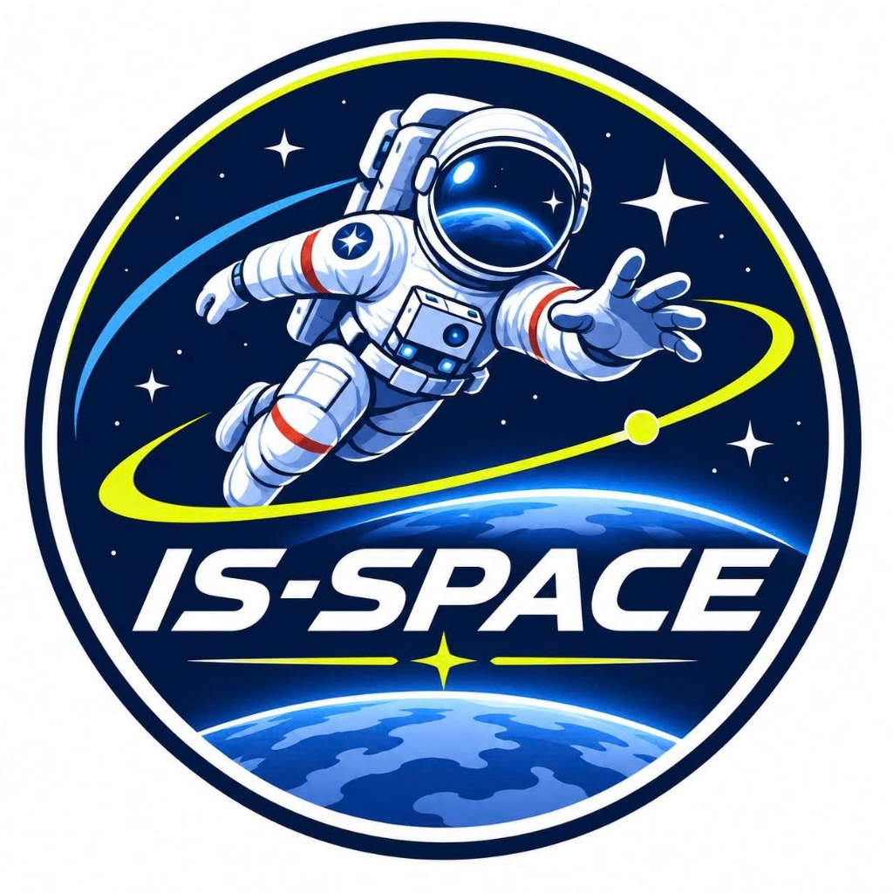
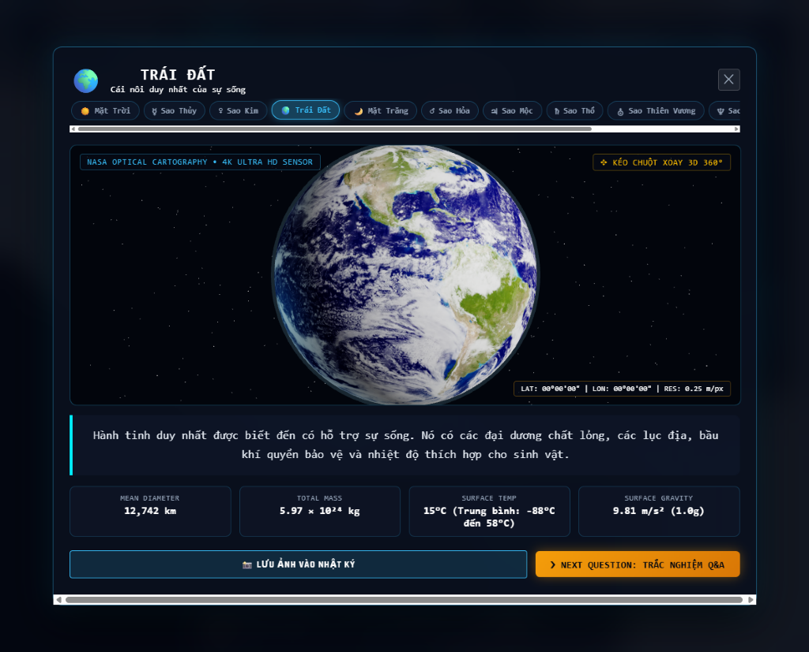
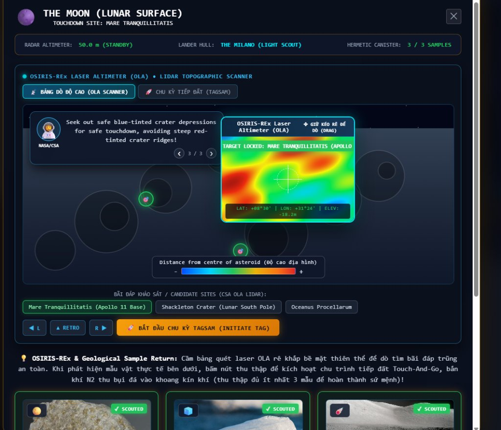
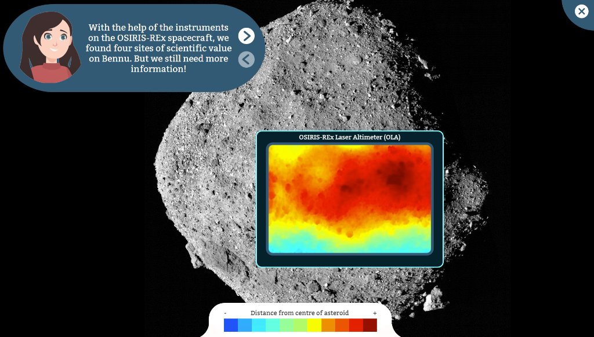
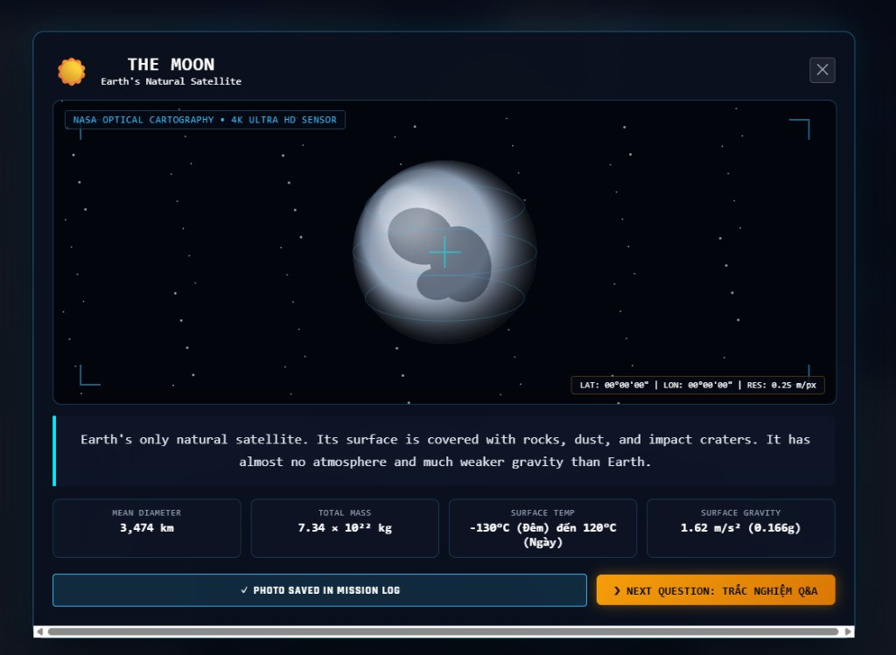
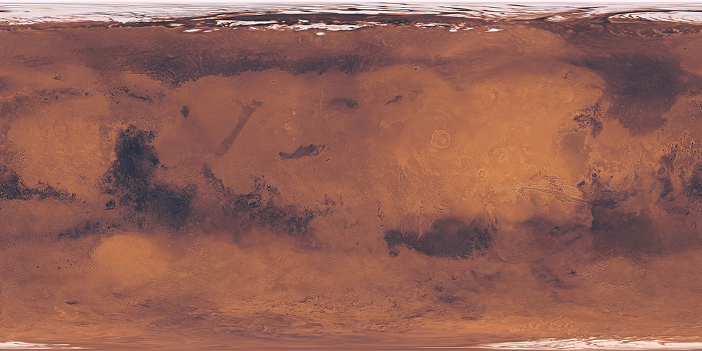
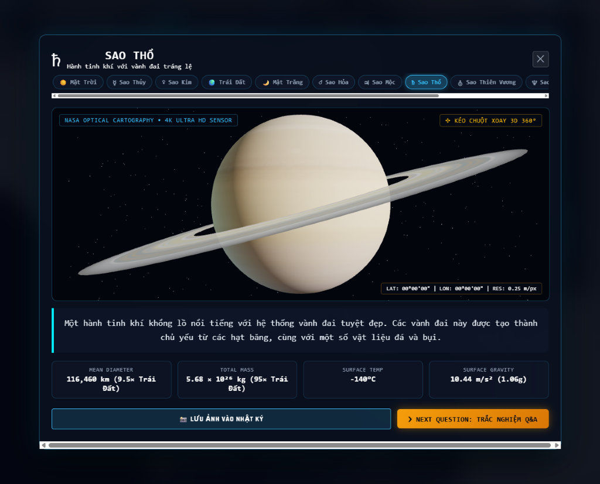
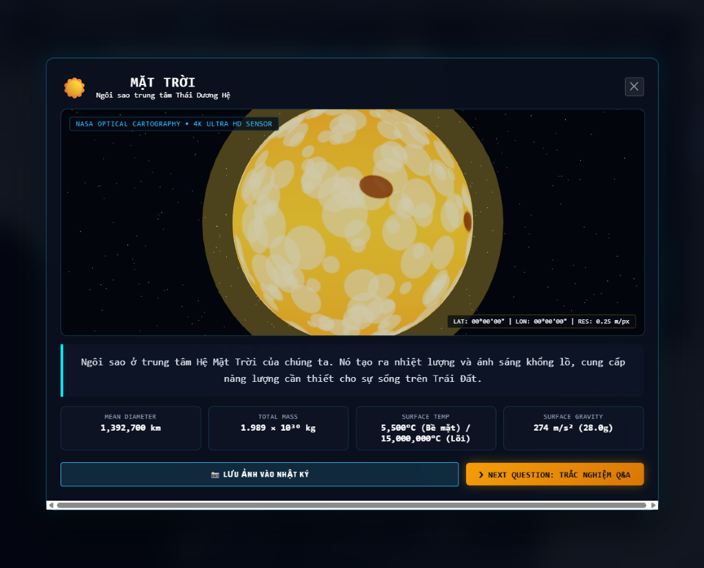

<div align="center">

# 🚀 NASA WebGL-Orbiter & Deep Space Mission Simulator
### Photorealistic 4K Keplerian Astrodynamics, 3D Cartographic Reconnaissance, Planetary Landing & OSIRIS-REx Sample Return Engine

[](LICENSE)
[](https://threejs.org/)
[](https://github.com/nasa/mission-viz)
[](https://www.asc-csa.gc.ca/eng/satellites/osiris-rex/activities/game.asp)
[](https://github.com/Logm12/nasa_game_challenge)
[](https://en.wikipedia.org/wiki/Orbital_mechanics)
[](https://www.netlify.com/)

[**Live Interactive Simulation**](https://msakuta.github.io/WebGL-Orbiter/index.html) • [**GitHub Repository**](https://github.com/Logm12/nasa_game_challenge) • [**NASA Mission-Viz**](https://github.com/nasa/mission-viz) • [**CSA OSIRIS-REx Challenge**](https://www.asc-csa.gc.ca/eng/satellites/osiris-rex/activities/game.asp)

<br/>



</div>

---

<a id="overview--mission-scope"></a>
## 🌌 Overview & Mission Scope

**NASA WebGL-Orbiter** is an advanced aerospace flight simulator, planetary reconnaissance platform, and astrodynamics laboratory running directly in the browser. Powered by **Three.js** and high-precision **Newtonian N-body gravitational mechanics**, it simulates the Solar System in true physical scale ($1\text{ AU} = 149,597,870.7\text{ km}$), rendering high-resolution **4K planetary bodies**, authentic atmospheric Rayleigh scattering, real-time Keplerian orbital elements, and official **NASA / CSA mission profiles** (Apollo 11, Artemis, DART, OSIRIS-REx Bennu Sample Return, Voyager, New Horizons).

Whether conducting orbital insertion around Jupiter, scanning celestial bodies with an **optical reconnaissance magnifying scope**, executing a **Touch-And-Go (TAGSAM)** surface descent to harvest ancient geological specimens, or piloting manual reaction-control docking maneuvers with active **SAS Gyroscopic Autopilot**, WebGL-Orbiter bridges theoretical spaceflight physics with AAA interactive aerospace engineering.

---

<a id="table-of-contents"></a>
## 📑 Table of Contents

1. [Key Features & Capabilities](#key-features--capabilities)
2. [NASA Space Apps Challenge: Flagship Mission Modules](#nasa-space-apps-challenge-flagship-mission-modules)
   - [2.1 Mission 1: 2D Cartographic Reconnaissance & Science Q&A Quiz Engine](#21-mission-1-2d-cartographic-reconnaissance--science-qa-quiz-engine)
   - [2.2 Mission 2: Surface Touchdown & OSIRIS-REx Geological Sample Return](#22-mission-2-surface-touchdown--osiris-rex-geological-sample-return)
   - [2.3 Optical Reconnaissance Magnifying Scope & Dark Landing Crater Detection](#23-optical-reconnaissance-magnifying-scope--dark-landing-crater-detection)
   - [2.4 Mandatory Lander Hull Architecture & Fleet Rules](#24-mandatory-lander-hull-architecture--fleet-rules)
   - [2.5 Congressional Discovery & New Frontiers Budget Dynamics](#25-congressional-discovery--new-frontiers-budget-dynamics)
3. [Representative Celestial Body Profiles & 3D Visual Gallery](#representative-celestial-body-profiles--3d-visual-gallery)
   - [3.1 The Earth (Terra)](#31-the-earth-terra)
   - [3.2 The Moon (Luna)](#32-the-moon-luna)
   - [3.3 Mars (Ares)](#33-mars-ares)
   - [3.4 Saturn (Cronus)](#34-saturn-cronus)
   - [3.5 The Sun (Sol)](#35-the-sun-sol)
   - [3.6 Asteroid 101955 Bennu](#36-asteroid-101955-bennu)
4. [Astrodynamics & Mathematical Formulations](#astrodynamics--mathematical-formulations)
   - [4.1 Newtonian Universal Gravitation & N-Body Perturbations](#41-newtonian-universal-gravitation--n-body-perturbations)
   - [4.2 Runge-Kutta 4th Order (RK4) Numerical Integration](#42-runge-kutta-4th-order-rk4-numerical-integration)
   - [4.3 Vis-Viva Equation & Orbital Velocities](#43-vis-viva-equation--orbital-velocities)
   - [4.4 State Vectors to Keplerian Orbital Elements](#44-state-vectors-to-keplerian-orbital-elements)
   - [4.5 Hohmann Transfer & Orbital Insertion](#45-hohmann-transfer--orbital-insertion)
   - [4.6 Gyroscopic Stability Assist (SAS) & Reaction Wheels](#46-gyroscopic-stability-assist-sas--reaction-wheels)
   - [4.7 Spherical Galactic Coordinate Mapping for 4K Deep Space](#47-spherical-galactic-coordinate-mapping-for-4k-deep-space)
5. [NASA Scientific Datasets & Planetary Ephemerides](#nasa-scientific-datasets--planetary-ephemerides)
6. [Unified Aerospace Flight Deck & Controls](#unified-aerospace-flight-deck--controls)
7. [Architecture & Project Structure](#architecture--project-structure)
8. [Building & Running Locally](#building--running-locally)
9. [License & Acknowledgments](#license--acknowledgments)

---

<a id="key-features--capabilities"></a>
## 🌟 Key Features & Capabilities

* **Authentic 4K Photorealistic Celestial Sphere**:
  - Custom 4096 × 2048 deep-space background synthesized from the Harvard Spectral Classification catalog (65,000+ stars with B-V color temperatures: O/B, A, F, G, K, M).
  - Inclined Milky Way galactic plane with dense Sagittarius core and intricate dark dust absorption rifts (Great Rift, Coalsack).
  - Deep-sky astronomical landmarks: Andromeda Galaxy (M31), Large and Small Magellanic Clouds (LMC/SMC), and stellar nurseries.
* **Interactive 3D Planet Reconnaissance Photography**:
  - Full 360° mouse-drag rotation for all 11 Solar System bodies with true physical spherical mapping, realistic axial tilt, and real-time atmospheric shaders.
* **OSIRIS-REx Laser Altimeter (OLA) Optical Scope**:
  - Interactive 1.85× magnification lens with sweeping radar line to scout terrain and locate safe dark landing crater depressions free of lethal boulders.
* **TAGSAM Touchdown Physics Engine**:
  - Real-time animated descent simulation with controllable retro/lateral thrusters, nitrogen (N₂) gas blast particle emission, and hermetic canister sample capture.
* **Planetary Geological Specimen Harvesting**:
  - Scientifically authentic rock, mineral, and volatile samples across Earth, Moon, Mars, and Asteroid Bennu with detailed planetary geology descriptions.
* **Unified Aerospace Flight Deck**:
  - Interactive plasma thrust slider with instant 100% `[Z]`, 50%, and `CUT [X]` engine presets.
  - High-visibility 3D Navball with live orbital velocity telemetry (m/s or km/s).
  - 6-DOF RCS tactile attitude controls (`Pitch`, `Yaw`, `Roll`) synchronized with physical keyboard inputs (`W/A/S/D/Q/E`).
  - Comprehensive **SAS Autopilot**: `STAB LOCK` (gyro active damping), `PROGRADE` ($V^+$ boost), `RETROGRADE` ($V^-$ brake), and `MANUAL`.
* **NASA Mission Designer & Custom Fleet Hangar**:
  - Official NASA exploration fleet: Space Shuttle Discovery (OV-103), Apollo 11 Lunar Module (Eagle), Voyager 1, Constellation-X, and Ares I.
  - Custom flagships: Quinjet Mk-VII Stealth Interceptor, The Milano, The Benatar, Sanctuary Flagship, Hyperion Dreadnought, and Ghostwing.
* **Instant Warp Orbital Insertion (`🚀 ESTABLISH ORBIT HERE`)**:
  - Instantly teleports spacecraft into a stable, circular Keplerian orbit around any target celestial body ($v = \sqrt{GM/r}$).
* **Ecliptic Cosmic Orrery Dock**:
  - Solar System planets, moons, hazardous asteroids (PHAs), extrasolar stars (Alpha Centauri, TRAPPIST-1, Sirius, Betelgeuse), and deep cosmos singularities (Gargantua, Sagittarius A*, Crab Pulsar).

---

<a id="nasa-space-apps-challenge-flagship-mission-modules"></a>
## 🎯 NASA Space Apps Challenge: Flagship Mission Modules

<a id="21-mission-1-2d-cartographic-reconnaissance--science-qa-quiz-engine"></a>
### 2.1 Mission 1: 2D Cartographic Reconnaissance & Science Q&A Quiz Engine

Mission 1 transforms passive orbital flight into an active quest for scientific discovery. When surveying any celestial body, astronauts can activate the high-resolution **Reconnaissance Camera** to inspect the target in 3D photorealistic fidelity, save captured imagery to the Mission Log, and validate their planetary science knowledge through a 4-choice Q&A quiz.

<div align="center">
  
  <p><em>Figure 1: Earth 3D Reconnaissance Photography Modal with interactive 360° mouse drag, planetary telemetry, and Q&A challenge.</em></p>
</div>

* **Scientific Coverage**: Sun, Mercury, Venus, Earth, Moon, Mars, Asteroid Belt, Jupiter, Saturn, Uranus, Neptune, and Asteroid 101955 Bennu.
* **Physical Telemetry Breakdown**: Mean Diameter (km), Total Mass (kg), Surface Temperature range (°C), and Surface Gravity (g).
* **Educational Q&A Bank**: Rigorous questions authored around planetary composition, greenhouse mechanisms, orbital resonance, and space mission milestones. Correct answers grant +50 Science Points.

---

<a id="22-mission-2-surface-touchdown--osiris-rex-geological-sample-return"></a>
### 2.2 Mission 2: Surface Touchdown & OSIRIS-REx Geological Sample Return

Sample return missions represent the gold standard of modern planetary science (Apollo 11 lunar basalt, OSIRIS-REx Bennu carbonaceous regolith, Perseverance Mars sample caching). Mission 2 challenges players to perform soft touchdown descents on landable bodies and harvest at least 3 distinct geological specimens to achieve mission certification.

<div align="center">
  
  <p><em>Figure 2: Surface Landing Console featuring the Draggable Optical Recon Scope, Candidate Sites, and Specimen Collection Cards.</em></p>
</div>

#### Authentic Geological Specimen Catalogue:
* **Earth (Crustal Geology)**:
  - *Granite Rock* (285g, Plutonic Igneous) — Slow-cooling magma crystallization.
  - *Basalt Rock* (310g, Extrusive Volcanic) — Rapidly cooled oceanic plate basalt.
  - *Sandstone Rock* (195g, Clastic Sedimentary) — Fluid and wind grain deposition.
* **The Moon (Lunar Regolith & Volatiles)**:
  - *Lunar Highlands Rock* (180g, Pristine Anorthosite) — Relic of the ancient magma ocean.
  - *Polar Water Ice* (240g, Cryogenic Volatile) — Trapped in permanently shadowed polar craters (Artemis target).
  - *Lunar Regolith Dust* (150g, Impact Breccia) — Pulverized by billions of years of micrometeorite bombardment.
* **Mars (Red Planet Stratigraphy)**:
  - *Martian Basaltic Rock* (220g, Ferric Volcanic) — Oxidized iron basalt recording past surface water.
  - *Atmospheric Gas Sample* (65g, Rarefied 95% CO₂) — Clues to Martian greenhouse stripping.
* **Asteroid 101955 Bennu (OSIRIS-REx Target)**:
  - *Bennu Carbonaceous Regolith* (121.6g, Organic-rich) — Primitive solar nebula material > 4.5 Gyr.
  - *Hydrothermal Magnetite Nodules* (64.2g, Aqueous Alteration) — Conclusive proof of ancient liquid water.
  - *Prebiotic Breccia Clast* (88.4g, Amino Acid Carrier) — Meteoritic shock breccia.

---

<a id="23-optical-reconnaissance-magnifying-scope--dark-landing-crater-detection"></a>
### 2.3 Optical Reconnaissance Magnifying Scope & Dark Landing Crater Detection

Inspired directly by the Canadian Space Agency (CSA) OSIRIS-REx Laser Altimeter (OLA) mission game ([CSA OLA Challenge](https://www.asc-csa.gc.ca/eng/satellites/osiris-rex/activities/game.asp)), WebGL-Orbiter incorporates a tactile, draggable **Optical Reconnaissance Scope**:

<div align="center">
  
  <p><em>Figure 3: Canadian Space Agency (CSA) OSIRIS-REx OLA LIDAR topographic mapping reference.</em></p>
</div>

1. **Magnification & Sweep**: Users grab and drag the scope handle across the terrain. The lens applies a 1.85× optical zoom and continuous radial radar sweep line.
2. **Safe Dark Landing Crater ("Chấm đen bãi đáp")**: Boulders and steep ridges pose catastrophic hazard to landers. Sweeping over candidate sites reveals the flat, safe dark crater basin inside the lens.
3. **Target Lock**: Once centered over a safe crater depression, the scope locks coordinates (`🎯 TARGET LOCKED`), turns the reticle green, displays latitude/longitude telemetry, and unlocks the corresponding geological specimen.
4. **TAGSAM Touch-And-Go Descent**: Switching to TAGSAM mode initiates descent. Players use Retro (`▲`), Left (`◀`), and Right (`▶`) thrusters to steer down safely. At contact altitude (0 m), high-pressure N₂ gas blast particles burst, collecting dust into the hermetically sealed canister.

---

<a id="24-mandatory-lander-hull-architecture--fleet-rules"></a>
### 2.4 Mandatory Lander Hull Architecture & Fleet Rules

In real NASA missions, mission requirements dictate spacecraft architecture. A space telescope or orbital satellite cannot perform planetary landings.

* **Authorized Landing Fleet (Mission 2: Sample Return)**:
  - `NASA Apollo 11 Lunar Module (Eagle)` — Dedicated lunar lander descent stage and quad landing gear pads.
  - `NASA Space Shuttle Discovery (OV-103)` — Heavy orbiter equipped with thermal heatshield and tricycle landing gear.
  - `Quinjet Mk-VII` — VTOL vector-thrust atmospheric transport craft.
  - `The Milano` — Planetary scout craft with reinforced landing skids.
* **Prohibited Craft**: Spacecraft lacking landing gear (orbital satbusses, long-range probes, deep-space battleships) are automatically locked and flagged with a red warning badge.

---

<a id="25-congressional-discovery--new-frontiers-budget-dynamics"></a>
### 2.5 Congressional Discovery & New Frontiers Budget Dynamics

Simulating realistic NASA program economics (Discovery Program ≤ $680M, New Frontiers ≤ $850M):

$$\text{TravelBudget}_{\text{reserve}} = \text{Budget}_{\text{initial}} - \sum \text{Cost}_{\text{equipment}} \ge 0$$

* Players must balance hull choice, engine efficiency, and payload costs against travel reserves.
* Interplanetary Hohmann transfers between celestial bodies deduct travel budget based on destination distance and gravitational well depth:
  - Moon Transfer: **-$5M** (M1) / **-$28M** (M2)
  - Mars Transfer: **-$9M** (M1) / **-$44M** (M2)
  - Asteroid Bennu: **-$12M** (M1) / **-$32M** (M2)
  - Outer Planets (Jupiter/Saturn): **-$17M** to **-$23M**
* If funds are depleted below transfer thresholds, the mission concludes and triggers the comprehensive debrief evaluation.

---

<a id="representative-celestial-body-profiles--3d-visual-gallery"></a>
## 🪐 Representative Celestial Body Profiles & 3D Visual Gallery

<a id="31-the-earth-terra"></a>
### 3.1 The Earth (Terra)
*The planetary cradle of life, featuring 4K dynamic Rayleigh atmospheric scattering and real-time cloud animation.*

<div align="center">
  
</div>

| Parameter | Value | Scientific Significance |
| :--- | :--- | :--- |
| **Mean Diameter** | 12,742 km | Largest terrestrial planet in the Solar System |
| **Total Mass** | 5.972 × 10²⁴ kg | Determines standard gravity ($g_0 = 9.80665\text{ m/s}^2$) |
| **Surface Temperature** | 15°C (Mean: -88°C to +58°C) | Resides stably inside the circumstellar habitable zone |
| **Atmospheric Composition** | 78% N₂, 21% O₂, 0.93% Ar, 0.04% CO₂ | Breathable surface pressure: 101.325 kPa |

---

<a id="32-the-moon-luna"></a>
### 3.2 The Moon (Luna)
*Earth's sole natural satellite, tidally locked with basaltic volcanic maria and permanently shadowed polar ice traps.*

<div align="center">
  
</div>

| Parameter | Value | Scientific Significance |
| :--- | :--- | :--- |
| **Mean Diameter** | 3,474 km | 0.273× Earth's diameter |
| **Total Mass** | 7.342 × 10²² kg | 1/81 mass of Earth; drives terrestrial ocean tides |
| **Surface Temperature** | -130°C (Night) to +120°C (Day) | Extreme thermal swings due to zero atmospheric shielding |
| **Surface Gravity** | 1.62 m/s² (0.166g) | Allows lightweight Apollo Lunar Module ascent stage |

---

<a id="33-mars-ares"></a>
### 3.3 Mars (Ares)
*The Red Planet, sculpted by ancient river deltas, colossal shield volcanoes, and global dust storms.*

<div align="center">
  
</div>

| Parameter | Value | Scientific Significance |
| :--- | :--- | :--- |
| **Mean Diameter** | 6,779 km (0.53× Earth) | Hosts Olympus Mons, the largest volcano in the Solar System |
| **Total Mass** | 6.417 × 10²³ kg (0.107× Earth) | Lower gravity facilitated ancient atmospheric hydrodynamic escape |
| **Surface Temperature** | -63°C (Mean: -140°C to +20°C) | Subsurface permafrost and polar water/dry-ice ice caps |
| **Surface Gravity** | 3.72 m/s² (0.379g) | Prime target for human interplanetary colonization & sample return |

---

<a id="34-saturn-cronus"></a>
### 3.4 Saturn (Cronus)
*The ringed jewel of our Solar System, rendered with authentic 3D ring geometry and self-shadowing.*

<div align="center">
  
</div>

| Parameter | Value | Scientific Significance |
| :--- | :--- | :--- |
| **Equatorial Diameter** | 116,460 km (9.45× Earth) | Rapid rotation causes pronounced oblate oblateness (0.098) |
| **Total Mass** | 5.683 × 10²⁶ kg (95.2× Earth) | Lowest mean density of all planets (0.687 g/cm³) |
| **Ring System Span** | Up to 282,000 km across | Over 99% water ice particles with Cassini division gap |
| **Surface Temperature** | -140°C | Hydrogen-helium gas giant atmosphere |

---

<a id="35-the-sun-sol"></a>
### 3.5 The Sun (Sol)
*The central thermonuclear powerplant of the Solar System, rendered with a custom GLSL dynamic noise shader.*

<div align="center">
  
</div>

| Parameter | Value | Scientific Significance |
| :--- | :--- | :--- |
| **Mean Diameter** | 1,392,700 km (109× Earth) | Contains 99.86% of total mass in the Solar System |
| **Total Mass** | 1.989 × 10³⁰ kg | Drives the gravitational barycenter of all planetary orbits |
| **Photosphere Temp** | 5,500°C (Surface) / 15,000,000°C (Core) | Powered by proton-proton chain nuclear fusion |
| **Surface Gravity** | 274.0 m/s² (27.94g) | Escape velocity: 617.5 km/s |

---

<a id="36-asteroid-101955-bennu"></a>
### 3.6 Asteroid 101955 Bennu
*Carbonaceous near-Earth rubble pile asteroid sampled by NASA OSIRIS-REx and CSA Canada.*

<div align="center">
  
</div>

| Parameter | Value | Scientific Significance |
| :--- | :--- | :--- |
| **Mean Diameter** | 492 m (Spinning top rubble-pile) | Low bulk density (1,190 kg/m³) indicating 50% porosity |
| **Total Mass** | 7.329 × 10¹⁰ kg | Microgravity regime (8 × 10⁻⁶ g) with regolith particle ejection |
| **Spectral Class** | B-type carbonaceous chondrite | Untouched primitive volatile reservoir from early Solar Nebula |
| **Touchdown Site** | Nightingale Crater | Targeted for low boulder density and fine-grained regolith beds |

---

<a id="astrodynamics--mathematical-formulations"></a>
## 📐 Astrodynamics & Mathematical Formulations

```
                      Z (Zenith / Normal)
                      ^
                      |     . - ~ ~ - .      Orbit Trajectory
                      |   /             \
                      |  /       r       \
                      | /                 \
                      |/                   \
                      O---------------------> Y (Velocity / Prograde)
                     / \                   /
                    /   \                 /
                   /     \               /
                  v        . - ~ ~ - .
                 X (Radial / Outward)
```

<a id="41-newtonian-universal-gravitation--n-body-perturbations"></a>
### 4.1 Newtonian Universal Gravitation & N-Body Perturbations
The acceleration $\mathbf{a}_i$ acting on an astronomical body or spacecraft $i$ with mass $m_i$ exerted by all other gravitating bodies $j$ is governed by Newton's law of universal gravitation:

$$\mathbf{a}_i = \frac{d^2\mathbf{r}_i}{dt^2} = \sum_{j \neq i} G M_j \frac{\mathbf{r}_j - \mathbf{r}_i}{\|\mathbf{r}_j - \mathbf{r}_i\|^3} + \mathbf{a}_{\text{thrust}}$$

Using the standard gravitational parameter $\mu_j = G M_j$:

$$\mathbf{a}_i = \sum_{j \neq i} \mu_j \frac{\mathbf{r}_j - \mathbf{r}_i}{\|\mathbf{r}_j - \mathbf{r}_i\|^3} + \frac{\mathbf{F}_{\text{engine}}}{m_i(t)}$$

---

<a id="42-runge-kutta-4th-order-rk4-numerical-integration"></a>
### 4.2 Runge-Kutta 4th Order (RK4) Numerical Integration
To preserve high numerical stability across variable timewarp scales (1× to 1,000,000×), positions and velocities are integrated using the 4th-order Runge-Kutta method:

Given the state vector $\mathbf{y} = [\mathbf{r}, \mathbf{v}]^T$ and $\frac{d\mathbf{y}}{dt} = f(t, \mathbf{y}) = [\mathbf{v}, \mathbf{a}(t, \mathbf{r})]^T$:

$$\mathbf{y}_{n+1} = \mathbf{y}_n + \frac{\Delta t}{6} \left( \mathbf{k}_1 + 2\mathbf{k}_2 + 2\mathbf{k}_3 + \mathbf{k}_4 \right)$$

where:
$$\begin{aligned}
\mathbf{k}_1 &= f(t_n, \mathbf{y}_n) \\
\mathbf{k}_2 &= f\left(t_n + \frac{\Delta t}{2}, \mathbf{y}_n + \frac{\Delta t}{2} \mathbf{k}_1\right) \\
\mathbf{k}_3 &= f\left(t_n + \frac{\Delta t}{2}, \mathbf{y}_n + \frac{\Delta t}{2} \mathbf{k}_2\right) \\
\mathbf{k}_4 &= f\left(t_n + \Delta t, \mathbf{y}_n + \Delta t \mathbf{k}_3\right)
\end{aligned}$$

---

<a id="43-vis-viva-equation--orbital-velocities"></a>
### 4.3 Vis-Viva Equation & Orbital Velocities
For any two-body Keplerian system with mass $M \gg m$, the instantaneous orbital speed $v$ at distance $r$ is:

$$v^2 = \mu \left( \frac{2}{r} - \frac{1}{a} \right)$$

* **Circular Orbital Velocity** ($r = a$, eccentricity $e = 0$):
  $$v_{\text{circ}} = \sqrt{\frac{\mu}{r}} = \sqrt{\frac{G M}{r}}$$
* **Escape Velocity (Vận tốc vũ trụ cấp 2)** ($a \to \infty$, parabolic trajectory):
  $$v_{\text{esc}} = \sqrt{\frac{2\mu}{r}} = \sqrt{2} \cdot v_{\text{circ}}$$
* **Apoapsis ($r_a$) and Periapsis ($r_p$) Speeds**:
  $$v_p = \sqrt{\frac{\mu}{a} \frac{1 + e}{1 - e}}, \qquad v_a = \sqrt{\frac{\mu}{a} \frac{1 - e}{1 + e}}$$

---

<a id="44-state-vectors-to-keplerian-orbital-elements"></a>
### 4.4 State Vectors to Keplerian Orbital Elements
The live telemetry HUD transforms position $\mathbf{r} = (x, y, z)$ and velocity $\mathbf{v} = (v_x, v_y, v_z)$ into the six classical orbital elements:

* **Specific Angular Momentum**: $\mathbf{h} = \mathbf{r} \times \mathbf{v}, \quad h = \|\mathbf{h}\|$
* **Node Vector**: $\mathbf{n} = \hat{\mathbf{k}} \times \mathbf{h} = (-h_y, h_x, 0)$
* **Eccentricity Vector & Magnitude**: $\mathbf{e} = \frac{1}{\mu} \left[ \left( v^2 - \frac{\mu}{r} \right) \mathbf{r} - (\mathbf{r} \cdot \mathbf{v}) \mathbf{v} \right], \quad e = \|\mathbf{e}\|$
* **Specific Orbital Energy & Semi-Major Axis ($a$)**: $\varepsilon = \frac{v^2}{2} - \frac{\mu}{r}, \quad a = -\frac{\mu}{2\varepsilon}$
* **Inclination ($i$)**: $i = \arccos \left( \frac{h_z}{h} \right)$
* **Longitude of Ascending Node ($\Omega$)**: $\Omega = \arccos\left(\frac{n_x}{\|\mathbf{n}\|}\right)$ (if $n_y \ge 0$, else $2\pi - \Omega$)
* **Argument of Periapsis ($\omega$)**: $\omega = \arccos\left(\frac{\mathbf{n} \cdot \mathbf{e}}{\|\mathbf{n}\| e}\right)$ (if $e_z \ge 0$, else $2\pi - \omega$)
* **True Anomaly ($\nu$)**: $\nu = \arccos\left(\frac{\mathbf{e} \cdot \mathbf{r}}{e r}\right)$ (if $\mathbf{r} \cdot \mathbf{v} \ge 0$, else $2\pi - \nu$)

---

<a id="45-hohmann-transfer--orbital-insertion"></a>
### 4.5 Hohmann Transfer & Orbital Insertion
Interplanetary travel calculations rely on coplanar Hohmann transfer trajectories:

$$\Delta v_1 = \sqrt{\frac{\mu}{r_1}} \left( \sqrt{\frac{2 r_2}{r_1 + r_2}} - 1 \right), \qquad \Delta v_2 = \sqrt{\frac{\mu}{r_2}} \left( 1 - \sqrt{\frac{2 r_1}{r_1 + r_2}} \right)$$

$$\Delta v_{\text{total}} = \Delta v_1 + \Delta v_2$$

---

<a id="46-gyroscopic-stability-assist-sas--reaction-wheels"></a>
### 4.6 Gyroscopic Stability Assist (SAS) & Reaction Wheels
In microgravity, zero-damping rotation causes persistent tumbling. The SAS autopilot active dampening algorithm models internal reaction wheel torque:

$$\mathbf{\omega}(t + \Delta t) = \mathbf{\omega}(t) \cdot \max\left(0, 1.0 - k_{\text{damp}} \frac{\Delta t}{\text{substeps}}\right)$$

When `PROGRADE` ($V^+$) or `RETROGRADE` ($V^-$) mode is engaged, the ship dynamically aligns its forward axis $\hat{\mathbf{u}}_{\text{fwd}} = (1, 0, 0)$ with target velocity unit vector $\hat{\mathbf{v}} = \pm \frac{\mathbf{v}}{\|\mathbf{v}\|}$:

$$\mathbf{q}_{\text{align}} = \text{Quaternion.fromUnitVectors}(\hat{\mathbf{u}}_{\text{fwd}}, \hat{\mathbf{v}})$$

$$\mathbf{q}_{\text{ship}}(t + \Delta t) = \text{Slerp}\left(\mathbf{q}_{\text{ship}}(t), \mathbf{q}_{\text{align}}, \alpha \cdot \Delta t\right)$$

---

<a id="47-spherical-galactic-coordinate-mapping-for-4k-deep-space"></a>
### 4.7 Spherical Galactic Coordinate Mapping for 4K Deep Space
To project the $4096 \times 2048$ deep-space celestial vault onto the simulation skybox without polar seam artifacts, astronomical equatorial coordinates (Right Ascension $\alpha$, Declination $\delta$) are transformed into 3D Cartesian coordinates on a sphere of radius $R_{\text{vault}} = 10^{12}\text{ m}$:

$$\begin{aligned}
x &= R_{\text{vault}} \cos(\delta) \cos(\alpha) \\
y &= R_{\text{vault}} \sin(\delta) \\
z &= R_{\text{vault}} \cos(\delta) \sin(\alpha)
\end{aligned}$$

Equirectangular texture UV coordinates for the custom background shader are given by:

$$u = \frac{\alpha}{2\pi} + 0.5, \qquad v = \frac{\delta}{\pi} + 0.5$$

---

<a id="nasa-scientific-datasets--planetary-ephemerides"></a>
## 🛰️ NASA Scientific Datasets & Planetary Ephemerides

All planetary ephemerides, radii, and gravitational constants are calibrated against official NASA Jet Propulsion Laboratory (JPL) astrodynamic tables:

| Celestial Body | Radius ($R$, km) | Standard Gravitational Parameter ($\mu = GM, \text{km}^3/\text{s}^2$) | Semi-Major Axis ($a$, AU) | Eccentricity ($e$) | Inclination ($i$) | Rotation Period |
| :--- | :---: | :---: | :---: | :---: | :---: | :---: |
| **The Sun (Sol)** | 695,800.0 | $1.32712440018 \times 10^{11}$ | — | — | — | 25.38 days |
| **Mercury** | 2,439.7 | $2.2032 \times 10^4$ | 0.387098 | 0.205630 | 7.005° | 58.646 days |
| **Venus** | 6,051.8 | $3.24859 \times 10^5$ | 0.723332 | 0.006773 | 3.394° | -243.025 days |
| **Earth** | 6,371.0 | $3.986004418 \times 10^5$ | 1.000000 | 0.016708 | 0.000° | 23h 56m 04s |
| **The Moon** | 1,737.4 | $4.9048695 \times 10^3$ | 0.002570 | 0.054900 | 5.145° | 27.321 days |
| **Mars** | 3,389.5 | $4.282837 \times 10^4$ | 1.523679 | 0.093400 | 1.850° | 24h 37m 22s |
| **Jupiter** | 69,911.0 | $1.26686534 \times 10^8$ | 5.204267 | 0.048498 | 1.303° | 9h 55m 30s |
| **Saturn** | 58,232.0 | $3.7931187 \times 10^7$ | 9.582600 | 0.055550 | 2.485° | 10h 33m 38s |
| **Uranus** | 25,362.0 | $5.793939 \times 10^6$ | 19.229411 | 0.047318 | 0.772° | -17h 14m 24s |
| **Neptune** | 24,622.0 | $6.836529 \times 10^6$ | 30.068963 | 0.008606 | 1.769° | 16h 06m 36s |

---

<a id="unified-aerospace-flight-deck--controls"></a>
## 🕹️ Unified Aerospace Flight Deck & Controls

```
+---------------------------------------------------------------------------------------+
|                                    FLIGHT DECK CONSOLE                                |
|  [MAIN THRUST]                   [3D NAVBALL & HEADING]                [AUTOPILOT / SAS]  |
|  +--+  100% [Z]                     ORBIT SPEED                         [ STAB LOCK ] |
|  |  |  50%                         10.5742 km/s                        [ PROGRADE  ] |
|  |##|  CUT  [X]                 (▲ W)  (↺ Q)  (↻ E)                     [RETROGRADE ] |
|  |##|                          (◀ A)  [NAV]  (▶ D)                     [  MANUAL   ] |
|  +--+  [+10%] [-10%]                   (▼ S)                                          |
+---------------------------------------------------------------------------------------+
```

<a id="hotkey-mappings"></a>
### Hotkey Mappings

| Control / Input | Primary Key | Description |
| :--- | :---: | :--- |
| **Throttle Maximum** | `Z` | Sets main engine thrust immediately to 100% |
| **Throttle Cutoff** | `X` | Halts engine instantly (0% thrust) to conserve propellant |
| **Throttle Up (Fine)** | `Shift` / `+10%` | Increments engine throttle by +10% |
| **Throttle Down (Fine)** | `Ctrl` / `-10%` | Decrements engine throttle by -10% |
| **Pitch Down** | `W` | Noses spacecraft downwards |
| **Pitch Up** | `S` | Noses spacecraft upwards |
| **Yaw Left** | `A` | Turns spacecraft nose left |
| **Yaw Right** | `D` | Turns spacecraft nose right |
| **Roll Counter-Clockwise** | `Q` | Rolls craft counter-clockwise |
| **Roll Clockwise** | `E` | Rolls craft clockwise |
| **TAGSAM Thruster Left** | `Arrow Left` | Fires port RCS thruster during planetary touchdown |
| **TAGSAM Thruster Right** | `Arrow Right` | Fires starboard RCS thruster during touchdown |
| **TAGSAM Thruster Retro** | `Arrow Up` | Fires braking thrusters to soften descent speed |
| **Timewarp Acceleration** | `+` / `=` | Speeds up physics simulation (1× to 1,000,000×) |
| **Timewarp Deceleration** | `-` | Slows down physics simulation to real-time |
| **Toggle Ecliptic Grids** | `G` | Toggles astronomical coordinate reference planes |
| **Toggle Chase Camera** | `H` | Locks camera view along velocity vector |
| **Instant Orbital Insertion** | *UI Button* | `🚀 ESTABLISH ORBIT HERE` inserts craft into stable Keplerian orbit |

---

<a id="architecture--project-structure"></a>
## 🏗️ Architecture & Project Structure

```
WebGL-Orbiter/
├── docs/
│   └── images/                    # High-resolution documentation screenshots & badges
│       ├── is_space_brand.jpg     # IS Space branding identity
│       ├── recon_earth.png        # Earth 3D recon photography & quiz modal
│       ├── recon_moon.jpg         # Moon surface cartography
│       ├── recon_mars.jpg         # Mars surface cartography & Viking mosaic
│       ├── recon_saturn.png       # Saturn 3D rings & telemetry
│       ├── recon_sun.png          # Sun thermonuclear dynamic shader
│       ├── landing_recon_scope.jpg# Touchdown console & OLA recon scope
│       └── csa_osiris_rex_game.jpg# Canadian Space Agency OLA reference
├── src/
│   ├── models/spacecraft/         # Official NASA 3D GLTF/GLB models
│   ├── images/
│   │   ├── samples/               # 4K Geological specimen photographs (Granite, Basalt, etc.)
│   │   ├── deep_space_4k.jpg      # High-fidelity 4K deep-space celestial vault
│   │   ├── land_ocean_ice_cloud*  # NASA Blue Marble 4K planetary surfaces
│   │   └── navball.png            # Aerospace attitude director indicator texture
│   ├── CelestialBody.ts           # N-body physics, orbital elements, SAS active damping
│   ├── FlightDeckControl.ts       # Unified aerospace console, throttle, and directional pad
│   ├── NasaMissionDesigner.ts     # NASA hangar, recon camera, OLA scope, TAGSAM touchdown
│   ├── nasa_mission_quiz_data.ts  # Science quiz bank, geological samples, landing sites
│   ├── PlanetaryVisuals.ts        # Earth day/night 4K Rayleigh shader & normal mapping
│   ├── SolarSystemExplorer.ts     # Top Cosmic Orrery dock, NASA dossiers & warp insertion
│   ├── SunVisuals.ts              # Thermonuclear photosphere shader & prominence loops
│   ├── TimeScaleControl.ts        # Timewarp clock controller
│   ├── Overlay.ts                 # 3D Navball Three.js sphere projection
│   ├── orbiter.ts                 # Main entrypoint, scene graph, and animation render loop
│   └── nasa_mission.css           # Modern aerospace glassmorphism UI styles
├── package.json                   # Dependencies, scripts, and build tasks
├── webpack.common.js              # Common Webpack bundler config
└── webpack.prod.js                # Optimized production build configuration
```

---

<a id="building--running-locally"></a>
## 🛠️ Building & Running Locally

<a id="prerequisites"></a>
### Prerequisites
* [Node.js](https://nodejs.org/) (v16+ recommended)
* `npm` package manager

<a id="installation--execution"></a>
### Installation & Execution

1. **Clone the repository**:
   ```bash
   git clone https://github.com/Logm12/nasa_game_challenge.git
   cd nasa_game_challenge
   ```

2. **Install dependencies**:
   ```bash
   npm install
   ```

3. **Start local development server**:
   ```bash
   npm start
   ```
   Open your browser at `http://localhost:8080`.

4. **Run automated test suite**:
   ```bash
   npm test
   ```

5. **Build production bundle**:
   ```bash
   npm run build
   ```
   Generates optimized `bundle.js` and assets inside the `dist/` directory.

---

<a id="license--acknowledgments"></a>
## 📜 License & Acknowledgments

* **Codebase License**: Released under the [MIT License](LICENSE).
* **NASA Data & Models**: Public domain, courtesy of the [National Aeronautics and Space Administration (NASA)](https://www.nasa.gov/), [NASA Scientific Visualization Studio](https://svs.gsfc.nasa.gov/), and [NASA JPL](https://www.jpl.nasa.gov/).
* **Canadian Space Agency (CSA)**: In gratitude for the educational [OSIRIS-REx OLA challenge](https://www.asc-csa.gc.ca/eng/satellites/osiris-rex/activities/game.asp) inspiring our optical reconnaissance scope and Bennu sample return mechanics.
* **Original Simulation Core**: Inspired by Masahiro Sakuta's orbital mechanics experiments and the legendary [Kerbal Space Program](https://www.kerbalspaceprogram.com/).
* **Graphics Framework**: Powered by [Three.js](https://threejs.org/).
