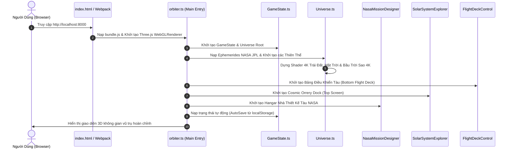
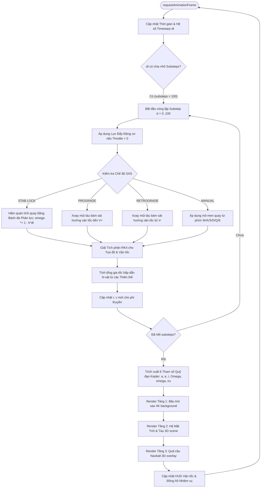
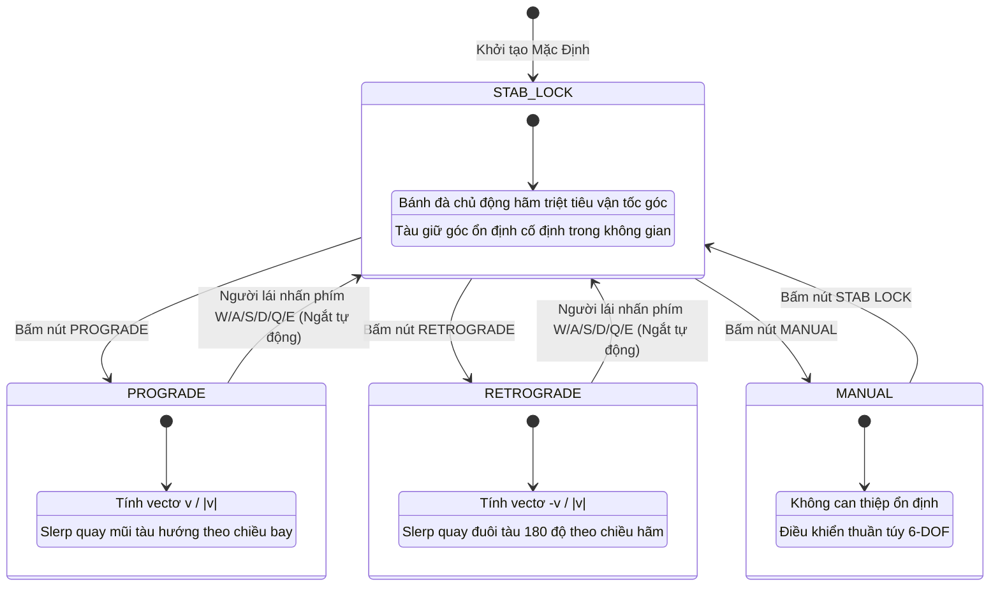
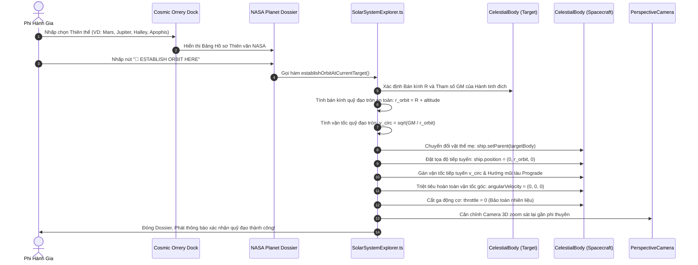

# 🛰️ NASA Space Mission Design & Orbital Simulator
## Tài Liệu Kiến Trúc Quy Trình (Project Workflow & Technical Architecture)
*Tài liệu nội bộ độc quyền — Dành cho nghiên cứu, đánh giá kỹ thuật và phát triển dự án.*

---

## 📑 Mục Lục

1. [Tổng Quan Hệ Thống & Phạm Vi Kiến Trúc](#1-tổng-quan-hệ-thống--phạm-vi-kiến-trúc)
2. [Chi Tiết Các Thành Phần (Component Architecture)](#2-chi-tiết-các-thành-phần-component-architecture)
3. [Thiết Kế Luồng Xử Lý & Dữ Liệu (Workflow & Data Flow Diagrams)](#3-thiết-kế-luồng-xử-lý--dữ-liệu-workflow--data-flow-diagrams)
   - [3.1 Luồng Khởi Động & Nạp Tài Nguyên (Bootstrapping & Asset Pipeline)](#31-luồng-khởi-động--nạp-tài-nguyên-bootstrapping--asset-pipeline)
   - [3.2 Luồng Vòng Lặp Mô Phỏng Vật Lý Quỹ Đạo (Physics Loop & RK4 Pipeline)](#32-luồng-vòng-lặp-mô-phỏng-vật-lý-quỹ-đạo-physics-loop--rk4-pipeline)
   - [3.3 Luồng Thiết Kế Nhiệm Vụ NASA (Mission Configuration & Trade-Offs)](#33-luồng-thiết-kế-nhiệm-vụ-nasa-mission-configuration--trade-offs)
   - [3.4 Luồng Điều Khiển Tàu Vũ Trụ & Lái Tự Động SAS (Flight Deck & Autopilot)](#34-luồng-điều-khiển-tàu-vũ-trụ--lái-tự-động-sas-flight-deck--autopilot)
   - [3.5 Luồng Dịch Chuyển Quỹ Đạo Tức Thời (Warp Orbital Insertion)](#35-luồng-dịch-chuyển-quỹ-đạo-tức-thời-warp-orbital-insertion)
4. [Hệ Thống Công Thức Toán Học & Vật Lý Thiên Văn](#4-hệ-thống-công-thức-toán-học--vật-lý-thiên-văn)
5. [Tập Dữ Liệu Khoa Học NASA Chính Thức](#5-tập-dữ-liệu-khoa-học-nasa-chính-thức)
6. [Quản Trị Trạng Thái & Lưu Trữ Dữ Liệu (State Persistence)](#6-quản-trị-trạng-thái--lưu-trữ-dữ-liệu-state-persistence)

---

## 1. Tổng Quan Hệ Thống & Phạm Vi Kiến Trúc

Dự án **NASA Space Mission Design & Orbital Simulator** được xây dựng nhằm mục đích cung cấp một phòng thí nghiệm astrodynamics hoàn chỉnh chạy trực tiếp trên nền tảng WebGL/Three.js. Kiến trúc phần mềm phân tầng rõ ràng giữa:
* **Tầng Giao Diện Người Dùng (Aerospace Cockpit & Mission GUI)**: HTML5/CSS3 Glassmorphism với độ phản hồi cao, không che khuất không gian 3D.
* **Tầng Động Lực Học Quỹ Đạo (Orbital Astrodynamics Engine)**: Mô phỏng bài toán $N$-vật tương tác trọng trường theo thời gian thực kết hợp thuật toán tích phân Runge-Kutta bậc 4 (RK4).
* **Tầng Cấu Hình Kỹ Thuật NASA (Systems Engineering Configurator)**: Đánh đổi đa mục tiêu giữa ngân sách, khối lượng tên lửa đẩy, suy giảm năng lượng Mặt Trời theo khoảng cách ($1/r^2$), và $\Delta v$ khả dụng theo phương trình Tsiolkovsky.
* **Tầng Đồ Họa 3D 4K (4K Photorealistic Visuals Pipeline)**: Dựng bầu trời sao thiên văn $4096 \times 2048$, bề mặt Trái Đất/Mặt Trăng chuẩn quang trắc học PBR, và hiệu ứng quầng quang cầu Mặt Trời GLSL.

---

## 2. Chi Tiết Các Thành Phần (Component Architecture)

Hệ thống được tổ chức thành các mô-đun TypeScript chuyên trách trong thư mục `src/`:

```
+-------------------------------------------------------------------------------------------------+
|                                        APPLICATION LAYER                                        |
|  +---------------------------+  +----------------------------+  +----------------------------+  |
|  |    SolarSystemExplorer    |  |     FlightDeckControl      |  |    NasaMissionDesigner     |  |
|  |  (Orrery Dock & Dossiers) |  | (Throttle, Navball, SAS)   |  | (Engineering Trade-Offs)   |  |
|  +-------------+-------------+  +--------------+-------------+  +--------------+-------------+  |
+----------------|-------------------------------|-------------------------------|----------------+
                 |                               |                               |
+----------------v-------------------------------v-------------------------------v----------------+
|                                    ORCHESTRATION & CORE                                         |
|  +-------------------------------------------------------------------------------------------+  |
|  |                                          orbiter.ts                                       |  |
|  |      - requestAnimationFrame Render Loop       - Dual-Scene Management (Sky & Space)      |  |
|  |      - Viewport Synchronization & Event Bus    - Camera Controller & Frustum Projection   |  |
|  +---------------------------------------------+---------------------------------------------+  |
|                                                |                                                |
|  +---------------------------------------------v---------------------------------------------+  |
|  |                                          GameState                                        |  |
|  |      - Variable Time-Warp Clock (1x to 1M x)   - Body Hierarchy & Celestial Registry      |  |
|  |      - Sub-step Simulation Scheduler           - LocalStorage State Serialization         |  |
|  +---------------------------------------------+---------------------------------------------+  |
+------------------------------------------------|------------------------------------------------+
                                                 |
+------------------------------------------------v------------------------------------------------+
|                                  PHYSICS & MATHEMATICAL ENGINE                                  |
|  +-------------------------------------------------------------------------------------------+  |
|  |                                        CelestialBody                                      |  |
|  |  - N-Body Gravitational Accumulation (Newton)   - Runge-Kutta 4th Order Integrator (RK4)  |  |
|  |  - Vis-Viva Velocity Calculations               - State Vector to Orbital Elements (OE)   |  |
|  |  - Gyroscopic Reaction Wheel Damping (SAS)      - Prograde / Retrograde Vector Alignment  |  |
|  +-------------------------------------------------------------------------------------------+  |
+-------------------------------------------------------------------------------------------------+
```

### 2.1 `orbiter.ts` (Bộ Điều Phối Chính & Render Pipeline)
* **Khởi tạo đồ họa**: Thiết lập WebGLRenderer với khử răng cưa `antialias: true`, quản lý ánh xạ dải màu `ACESFilmicToneMapping`, và không gian màu `sRGBEncoding`.
* **Kỹ thuật Render Hai Tầng (Dual-Scene Rendering)**:
  - Tầng nền (`background` Scene): Dựng khối cầu vòm trời sao `SphereGeometry(500, 64, 64)` độc lập, camera đặt tại $(0,0,0)$ sao cho bầu trời sao cố định ở vô cực.
  - Tầng vật thể thực (`scene` Scene): Chứa Mặt Trời, các hành tinh, tiểu hành tinh, quỹ đạo elip và tàu vũ trụ.
  - Tầng Overlay Three.js: Dựng quả cầu Navball 3D và các con trỏ vectơ `Prograde` / `Retrograde`.

### 2.2 `CelestialBody.ts` (Lõi Vật Lý Quỹ Đạo & Con Quay Hồi Chuyển)
* Quản lý trạng thái động học: Tọa độ vị trí $\mathbf{r}$, vận tốc $\mathbf{v}$, gia tốc $\mathbf{a}$, vận tốc góc quay $\mathbf{\omega}$, và góc quay Quaternion $\mathbf{q}$.
* Tích hợp thuật toán tính toán 6 tham số quỹ đạo Keplerian cổ điển từ vectơ trạng thái.
* Tích hợp bộ ổn định hồi chuyển SAS (Active Gyro Damping) giúp triệt tiêu quán tính lộn nhào khi người chơi ngắt lệnh xoay mũi tàu.
* Tự động tính toán vectơ hướng bay `PROGRADE` ($V^+$) và `RETROGRADE` ($V^-$).

### 2.3 `FlightDeckControl.ts` (Bảng Điều Khiển Tàu Vũ Trụ Thống Nhất)
* **Cánh Trái**: Điều khiển động cơ chính (Thrust Wing) với thanh trượt plasma trực quan, các nút lệnh nhanh `100% [Z]`, `50%`, `CUT [X]`, và các bước tinh chỉnh $\pm 10\%$.
* **Cụm Trung Tâm**: Khung viền Navball bọc ngoài khối cầu 3D, hiển thị thời gian thực vận tốc quỹ đạo (Orbit Speed) và cụm 6 phím điều hướng xúc giác `W/S/A/D/Q/E` phát sáng đồng bộ khi bấm phím vật lý.
* **Cánh Phải**: Hệ thống lái tự động SAS với 4 chế độ: `STAB LOCK`, `PROGRADE`, `RETROGRADE`, và `MANUAL`.

### 2.4 `NasaMissionDesigner.ts` (Bộ Thiết Kế Nhiệm Vụ & Cân Bằng Kỹ Thuật NASA)
* Hiện thực hóa toàn bộ quy chuẩn của đề bài **NASA Space Apps Challenge**:
  - 4 sứ mệnh mục tiêu: Mặt Trăng (Artemis), Sao Hỏa (Sample Return), Europa (Ocean Radar), và Điểm Lagrange L2 (Habitable Worlds Observatory).
  - Định luật suy giảm năng lượng Mặt Trời nghịch đảo bình phương $P(r) = P_0 / r^2$.
  - Đánh đổi khối lượng khô, khối lượng nhiên liệu và tải trọng tối đa của các dòng tên lửa đẩy thực tế (Electron, Falcon 9, Falcon Heavy, NASA SLS).
  - Kiểm tra điều kiện $\Delta v$ theo phương trình Tsiolkovsky trước khi cho phép phóng tàu.
  - Bảng vinh danh và xếp hạng kết thúc nhiệm vụ (Mission Debriefing).

### 2.5 `SolarSystemExplorer.ts` (Thanh Thiên Văn Cosmic Orrery & Hồ Sơ NASA)
* Thanh điều hướng trên đỉnh màn hình phân loại 3 tầng không gian: Hệ Mặt Trời, Các Hệ Sao Ngoại Hệ, và Vũ Trụ Sâu.
* Cung cấp hồ sơ thiên văn chuẩn NASA (NASA Scientific Dossier) hiển thị đường kính, khối lượng, trọng lực bề mặt, chu kỳ quỹ đạo và thành phần khí quyển.
* **Nút bấm `🚀 ESTABLISH ORBIT HERE`**: Dịch chuyển phi thuyền vào quỹ đạo tròn Keplerian ổn định quanh thiên thể đích ngay tức thì ($v = \sqrt{GM/r}$).

### 2.6 `SunVisuals.ts` & `PlanetaryVisuals.ts` (Hiệu Ứng Hình Ảnh Thiên Thể 4K)
* `SunVisuals`: Shader quang cầu Mặt Trời (Photosphere Simplex Noise) mô phỏng dòng đối lưu plasma nhiệt hạch, quầng nhật hoa thể tích (Volumetric Corona) và 12 cung tai lửa bùng nổ (Magnetic Prominences).
* `PlanetaryVisuals`: Shader Trái Đất kết hợp bản đồ bề mặt 4K, bản đồ thành phố đêm NASA Black Marble, dải hoàng hôn tán xạ Rayleigh khí quyển và bề mặt Mặt Trăng từ dữ liệu máy đo laser LOLA.

---

## 3. Thiết Kế Luồng Xử Lý & Dữ Liệu (Workflow & Data Flow Diagrams)

### 3.1 Luồng Khởi Động & Nạp Tài Nguyên (Bootstrapping & Asset Pipeline)



---

### 3.2 Luồng Vòng Lặp Mô Phỏng Vật Lý Quỹ Đạo (Physics Loop & RK4 Pipeline)



---

### 3.3 Luồng Thiết Kế Nhiệm Vụ NASA (Mission Configuration & Trade-Offs)

```mermaid
flowchart LR
    subgraph Step1 [Bước 1: Chọn Sứ Mệnh]
        M1[Artemis Moon Ice]
        M2[Mars Sample Return]
        M3[Europa Ocean Radar]
        M4[Habitable Worlds L2]
    end

    subgraph Step2 [Bước 2: Cân Bằng Phân Hệ Kỹ Thuật]
        Bus[Khung Thân Tàu: CubeSat / Discovery / Flagship]
        Power[Nguồn Điện: Tấm pin UltraFlex / Hạt nhân RTG]
        Payload[Cảm biến: Radar, Camera, Phổ kế khoáng]
        Propulsion[Động cơ: Hydrazine / Hypergolic / Ion Xenon]
    end

    subgraph Step3 [Bước 3: Thẩm Định Ràng Buộc Đề Bài NASA]
        BudgetCheck{Ngân Sách >= $0M?}
        MassCheck{Khối Lượng <= Tải trọng Tên lửa?}
        PowerCheck{Công Suất Dư > 0W?}
        DeltaVCheck{Delta V tính toán >= Yêu cầu?}
    end

    subgraph Step4 [Bước 4: Phê Duyệt & Phóng Bay]
        Launch[Nút: APPROVE FLIGHT & LAUNCH]
        Sim3D[Chuyển cảnh vào Buồng Lái 3D WebGL-Orbiter]
    end

    Step1 --> Step2
    Step2 --> BudgetCheck
    BudgetCheck -- Đạt --> MassCheck
    MassCheck -- Đạt --> PowerCheck
    PowerCheck -- Đạt --> DeltaVCheck
    DeltaVCheck -- Đạt --> Launch
    Launch --> Sim3D

    BudgetCheck -- Không đạt --> Error1[Báo đỏ Ngân sách]
    MassCheck -- Không đạt --> Error2[Báo đỏ Vượt tải trọng]
    PowerCheck -- Không đạt --> Error3[Báo đỏ Thiếu điện năng]
    DeltaVCheck -- Không đạt --> Error4[Báo đỏ Không đủ Delta-V]
```



---

### 3.4 Luồng Điều Khiển Tàu Vũ Trụ & Lái Tự Động SAS (Flight Deck & Autopilot)



---

### 3.5 Luồng Dịch Chuyển Quỹ Đạo Tức Thời (Warp Orbital Insertion)



---

## 4. Hệ Thống Công Thức Toán Học & Vật Lý Thiên Văn

Dự án hiện thực hóa các công thức toán - lý chuẩn mực quốc tế:

### 4.1 Định Luật Vạn Vật Hấp Dẫn Newton ($N$-Body Problem)
Gia tốc tổng hợp $\mathbf{a}_i$ tác dụng lên một thực thể $i$ bởi tất cả các thiên thể $j$ trong vũ trụ:

$$\mathbf{a}_i = \sum_{j \neq i} \frac{G M_j}{\|\mathbf{r}_j - \mathbf{r}_i\|^3} (\mathbf{r}_j - \mathbf{r}_i) + \frac{\mathbf{F}_{\text{thrust}}}{m_i(t)}$$

Trong đó hằng số hấp dẫn chuẩn $\mu_j = G M_j$ được tính toán trực tiếp từ dữ liệu thiên văn NASA JPL.

---

### 4.2 Tích Phân Số Runge-Kutta Bậc 4 (RK4)
Cho phương trình vi phân trạng thái động học $\frac{d\mathbf{y}}{dt} = f(t, \mathbf{y}) = [\mathbf{v}, \mathbf{a}(t, \mathbf{r})]^T$:

$$\mathbf{y}_{n+1} = \mathbf{y}_n + \frac{\Delta t}{6} \left( \mathbf{k}_1 + 2\mathbf{k}_2 + 2\mathbf{k}_3 + \mathbf{k}_4 \right)$$

Hệ thống 4 hệ số bước tính vi phân:
$$\mathbf{k}_1 = f(t_n, \mathbf{y}_n)$$
$$\mathbf{k}_2 = f\left(t_n + \frac{\Delta t}{2}, \mathbf{y}_n + \frac{\Delta t}{2}\mathbf{k}_1\right)$$
$$\mathbf{k}_3 = f\left(t_n + \frac{\Delta t}{2}, \mathbf{y}_n + \frac{\Delta t}{2}\mathbf{k}_2\right)$$
$$\mathbf{k}_4 = f(t_n + \Delta t, \mathbf{y}_n + \Delta t \mathbf{k}_3)$$

---

### 4.3 Phương Trình Tên Lửa Tsiolkovsky ($\Delta v$ Budget)
Vận tốc biến thiên cực đại của động cơ phản lực:

$$\Delta v = I_{\text{sp}} \cdot g_0 \cdot \ln \left( \frac{m_{\text{wet}}}{m_{\text{dry}}} \right) = I_{\text{sp}} \cdot g_0 \cdot \ln \left( 1 + \frac{m_{\text{propellant}}}{m_{\text{dry}}} \right)$$

* $I_{\text{sp}}$: Xung lực riêng của chất đẩy (giây).
* $g_0 = 9.80665\text{ m/s}^2$: Gia tốc trọng trường chuẩn bề mặt Trái Đất.
* $m_{\text{wet}} = m_{\text{dry}} + m_{\text{propellant}}$: Khối lượng ướt toàn phần lúc bắt đầu đốt động cơ.

---

### 4.4 Phương Trình Vis-Viva & Các Mức Vận Tốc Vũ Trụ
Vận tốc tức thời $v$ của một vật thể ở khoảng cách $r$ tính từ tâm hấp dẫn trên một quỹ đạo có bán trục lớn $a$:

$$v^2 = \mu \left( \frac{2}{r} - \frac{1}{a} \right)$$

* **Vận tốc quỹ đạo tròn ($r = a, e = 0$)**:
  $$v_{\text{circ}} = \sqrt{\frac{\mu}{r}} = \sqrt{\frac{G M}{r}}$$
* **Vận tốc thoát ly / Vận tốc vũ trụ cấp 2 ($a \to \infty$)**:
  $$v_{\text{esc}} = \sqrt{\frac{2\mu}{r}} = \sqrt{2} \cdot v_{\text{circ}}$$
* **Vận tốc tại cận điểm ($r_p$) và viễn điểm ($r_a$)**:
  $$v_p = \sqrt{\frac{\mu}{a} \left( \frac{1 + e}{1 - e} \right)}, \qquad v_a = \sqrt{\frac{\mu}{a} \left( \frac{1 - e}{1 + e} \right)}$$

---

### 4.5 Trích Xuất 6 Tham Số Quỹ Đạo Kepler Từ Vectơ Trạng Thái $(\mathbf{r}, \mathbf{v})$
Từ vectơ tọa độ $\mathbf{r} = (x, y, z)$ và vectơ vận tốc $\mathbf{v} = (v_x, v_y, v_z)$:

1. **Vectơ mô-men động lượng riêng**: $\mathbf{h} = \mathbf{r} \times \mathbf{v}, \quad h = \|\mathbf{h}\|$
2. **Vectơ đường nút**: $\mathbf{n} = \hat{\mathbf{z}} \times \mathbf{h} = (-h_y, h_x, 0)$
3. **Vectơ độ lệch tâm**:
   $$\mathbf{e} = \frac{1}{\mu} \left[ \left( v^2 - \frac{\mu}{r} \right) \mathbf{r} - (\mathbf{r} \cdot \mathbf{v}) \mathbf{v} \right], \quad e = \|\mathbf{e}\|$$
4. **Năng lượng quỹ đạo riêng & Bán trục lớn ($a$)**:
   $$\varepsilon = \frac{v^2}{2} - \frac{\mu}{r} = -\frac{\mu}{2a} \implies a = -\frac{\mu}{2\varepsilon}$$
5. **Độ nghiêng quỹ đạo ($i$)**: $i = \arccos\left(\frac{h_z}{h}\right)$
6. **Kinh độ điểm nút lên ($\Omega$)**:
   $$\Omega = \begin{cases} \arccos\left(\frac{n_x}{\|\mathbf{n}\|}\right) & n_y \ge 0 \\ 2\pi - \arccos\left(\frac{n_x}{\|\mathbf{n}\|}\right) & n_y < 0 \end{cases}$$
7. **Góc cận điểm ($\omega$)**:
   $$\omega = \begin{cases} \arccos\left(\frac{\mathbf{n} \cdot \mathbf{e}}{\|\mathbf{n}\| e}\right) & e_z \ge 0 \\ 2\pi - \arccos\left(\frac{\mathbf{n} \cdot \mathbf{e}}{\|\mathbf{n}\| e}\right) & e_z < 0 \end{cases}$$
8. **Dị thường thực ($\nu$)**:
   $$\nu = \begin{cases} \arccos\left(\frac{\mathbf{e} \cdot \mathbf{r}}{e r}\right) & \mathbf{r} \cdot \mathbf{v} \ge 0 \\ 2\pi - \arccos\left(\frac{\mathbf{e} \cdot \mathbf{r}}{e r}\right) & \mathbf{r} \cdot \mathbf{v} < 0 \end{cases}$$

---

### 4.6 Quỹ Đạo Chuyển Tiếp Hohmann Liên Hành Tinh
Đốt động cơ 2 giai đoạn chuyển từ quỹ đạo bán kính $r_1$ sang $r_2$:

$$\Delta v_1 = \sqrt{\frac{\mu}{r_1}} \left( \sqrt{\frac{2 r_2}{r_1 + r_2}} - 1 \right)$$
$$\Delta v_2 = \sqrt{\frac{\mu}{r_2}} \left( 1 - \sqrt{\frac{2 r_1}{r_1 + r_2}} \right)$$
$$\Delta v_{\text{total}} = \Delta v_1 + \Delta v_2$$

Thời gian bay một chiều (nửa chu kỳ elip chuyển tiếp):

$$t_{\text{transfer}} = \pi \sqrt{\frac{(r_1 + r_2)^3}{8\mu}}$$

---

### 4.7 Định Luật Suy Giảm Năng Lượng Mặt Trời Nghịch Đảo Bình Phương ($1/r^2$)
Công suất phát điện $P_{\text{solar}}$ của các tấm pin quang điện tại khoảng cách $r$ (tính bằng AU):

$$P_{\text{solar}}(r) = P_0 \left( \frac{r_0}{r} \right)^2 = \frac{1400\text{ W}}{r^2}$$

* Ở Trái Đất ($r = 1.0\text{ AU}$): $P = 1400\text{ W}$.
* Ở Sao Hỏa ($r = 1.52\text{ AU}$): $P = \frac{1400}{1.52^2} \approx 605\text{ W}$.
* Ở Europa / Sao Mộc ($r = 5.20\text{ AU}$): $P = \frac{1400}{5.20^2} \approx 51.8\text{ W}$.

---

### 4.8 Phương Trình Hãm Quán Tính Hồi Chuyển SAS & Vector Slerp
Khi bật chế độ `STAB LOCK`, vận tốc góc quay của tàu bị hãm chủ động bởi bánh đà phản lực:

$$\mathbf{\omega}(t + \Delta t) = \mathbf{\omega}(t) \cdot \max\left(0, 1.0 - k_{\text{damp}} \frac{\Delta t}{\text{substeps}}\right), \quad k_{\text{damp}} = 16.0\text{ s}^{-1}$$

Khi bật `PROGRADE` hoặc `RETROGRADE`, góc quay tàu $\mathbf{q}_{\text{ship}}$ tự động bám theo vectơ hướng đích $\hat{\mathbf{v}}_{\text{target}}$ bằng phép nội suy cầu Slerp:

$$\mathbf{q}_{\text{target}} = \text{quatFromVectors}\left((1, 0, 0), \hat{\mathbf{v}}_{\text{target}}\right)$$
$$\mathbf{q}_{\text{ship}}(t + \Delta t) = \text{Slerp}\left(\mathbf{q}_{\text{ship}}(t), \mathbf{q}_{\text{target}}, \alpha \cdot \Delta t\right)$$

---

### 4.9 Lượng Giác Cầu Chuyển Đổi Tọa Độ Thiên Hà Cho Bầu Trời Sao 4K
Chuyển đổi từ tọa độ xích đạo thiên cầu $(\alpha, \delta)$ sang tọa độ thiên hà $(l, b)$:

$$\sin(b) = \sin(\delta) \sin(\delta_G) + \cos(\delta) \cos(\delta_G) \cos(\alpha - \alpha_G)$$
$$\cos(b) \sin(l_0 - l) = \cos(\delta) \sin(\alpha - \alpha_G)$$
$$\cos(b) \cos(l_0 - l) = \sin(\delta) \cos(\delta_G) - \cos(\delta) \sin(\delta_G) \cos(\alpha - \alpha_G)$$

* Cực Bắc Thiên Hà (J2000): $\alpha_G = 192.85948^\circ$, $\delta_G = 27.12825^\circ$.
* Gốc kinh độ thiên hà: $l_0 = 32.93192^\circ$.

---

## 5. Tập Dữ Liệu Khoa Học NASA Chính Thức

### 5.1 Bảng Thông Số Hệ Mặt Trời NASA JPL Horizons

| Thiên thể | Bán kính ($R$, km) | Hằng số hấp dẫn ($\mu = GM, \text{km}^3/\text{s}^2$) | Bán trục lớn ($a$, AU) | Độ lệch tâm ($e$) | Độ nghiêng ($i$) | Chu kỳ tự quay |
| :--- | :---: | :---: | :---: | :---: | :---: | :---: |
| **Mặt Trời (Sol)** | $695.800$ | $1,32712440018 \times 10^{11}$ | — | — | — | $25,38\text{ ngày}$ |
| **Sao Thủy** | $2.439,7$ | $2,2032 \times 10^4$ | $0,387098$ | $0,205630$ | $7,005^\circ$ | $58,646\text{ ngày}$ |
| **Sao Kim** | $6.051,8$ | $3,24859 \times 10^5$ | $0,723332$ | $0,006773$ | $3,394^\circ$ | $-243,025\text{ ngày}$ |
| **Trái Đất** | $6.371,0$ | $3,986004418 \times 10^5$ | $1,000000$ | $0,016708$ | $0,000^\circ$ | $23\text{h } 56\text{m } 04\text{s}$ |
| **Mặt Trăng** | $1.737,4$ | $4,9048695 \times 10^3$ | $0,002570$ | $0,054900$ | $5,145^\circ$ | $27,321\text{ ngày}$ |
| **Sao Hỏa** | $3.389,5$ | $4,282837 \times 10^4$ | $1,523679$ | $0,093400$ | $1,850^\circ$ | $24\text{h } 37\text{m } 22\text{s}$ |
| **Sao Mộc** | $69.911,0$ | $1,26686534 \times 10^8$ | $5,204267$ | $0,048498$ | $1,303^\circ$ | $9\text{h } 55\text{m } 30\text{s}$ |
| **Sao Thổ** | $58.232,0$ | $3,7931187 \times 10^7$ | $9,582600$ | $0,055550$ | $2,485^\circ$ | $10\text{h } 33\text{m } 38\text{s}$ |
| **Sao Thiên Vương** | $25.362,0$ | $5,793939 \times 10^6$ | $19,229411$ | $0,047318$ | $0,772^\circ$ | $-17\text{h } 14\text{m } 24\text{s}$ |
| **Sao Hải Vương** | $24.622,0$ | $6,836529 \times 10^6$ | $30,068963$ | $0,008606$ | $1,769^\circ$ | $16\text{h } 06\text{m } 36\text{s}$ |

---

### 5.2 Tiểu Hành Tinh Nguy Hiểm NASA CNEOS (PHAs) & Radar Telemetry

* **99942 Apophis**: $a = 0.922\text{ AU}, e = 0.191, R \approx 185\text{ m}$. Tiếp cận Trái Đất ở khoảng cách cực gần vào ngày 13/04/2029 ($< 32.000\text{ km}$).
* **101955 Bennu**: $a = 1.126\text{ AU}, e = 0.203, R \approx 245\text{ m}$. Đối tượng lấy mẫu đất đá của tàu NASA OSIRIS-REx.
* **65803 Didymos & Dimorphos**: $a = 1.644\text{ AU}, e = 0.384$. Mục tiêu của sứ mệnh thử nghiệm chuyển hướng tiểu hành tinh NASA DART (2022).
* **(29075) 1950 DA**: $a = 1.699\text{ AU}, e = 0.507, R \approx 650\text{ m}$. Tiểu hành tinh nguy hiểm cấp độ cao với xác suất va chạm được NASA theo dõi sát sao.
* **433 Eros**: $a = 1.458\text{ AU}, e = 0.223$. Tiểu hành tinh đầu tiên có tàu vũ trụ hạ cánh (NASA NEAR Shoemaker).
* **1P/Halley**: $a = 17.834\text{ AU}, e = 0.967, i = 162.3^\circ$. Sao chổi chuyển động ngược chiều với chu kỳ $\approx 75,3\text{ năm}$.

---

## 6. Quản Trị Trạng Thái & Lưu Trữ Dữ Liệu (State Persistence)

Hệ thống quản lý trạng thái đồng bộ và tự động lưu trữ thông qua cơ chế kép:

1. **AutoSave (`localStorage`)**:
   * Khi người dùng rời khỏi trang hoặc reload trình duyệt (`beforeunload` event), toàn bộ trạng thái vũ trụ (vị trí, vận tốc, khối lượng, góc quay, mức ga động cơ của phi thuyền và tất cả thiên thể) được tuần tự hóa (serialize) thành chuỗi JSON lưu tại khóa `WebGLOrbiterAutoSave`.
   * Khi khởi động lại (`pageshow` event), hệ thống tự động giải mã và phục hồi chính xác vị trí tàu tại thời điểm rời đi.
2. **Kịch Bản Lưu Trữ Theo Yêu Cầu (Save/Load Slots)**:
   * Người chơi có thể tạo không giới hạn các điểm lưu trạng thái (Save State) độc lập với tên gọi tùy biến để thử nghiệm nhiều phương án quỹ đạo khác nhau mà không sợ mất dữ liệu.
